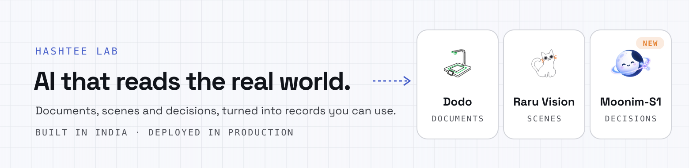

  

**Hashtee Lab** builds AI that reads the real world and turns what it reads into structured records and decisions
your systems can act on. Built in India. Deployed in production.

| | What it does | |
|---|---|---|
| **Dodo** | Document understanding. Scan invoices, purchase orders, KYC forms and handwritten registers on a desk scanner, a phone or through an API, and get verified, structured data in the tools you already use. | [getdodo.in](https://getdodo.in) |
| **Raru Vision** | Scene understanding. Reads the shelves, racks, counters and production lines your existing cameras already see, and turns operational checks into records. Early access. | [hashteelab.com/raru](https://www.hashteelab.com/en/raru) |
| **Moonim-S1** | A decision model for Indian languages. Reads tickets, chats, call transcripts and applications in 16 Indian languages and styles and makes the call, with how sure it is. API, research preview. | [hashteelab.com/moonim-s1](https://www.hashteelab.com/en/moonim-s1) |

**Get in touch:** [hello@hashteelab.com](mailto:hello@hashteelab.com) ·
[website](https://www.hashteelab.com) · [LinkedIn](https://www.linkedin.com/company/hashteelab)
